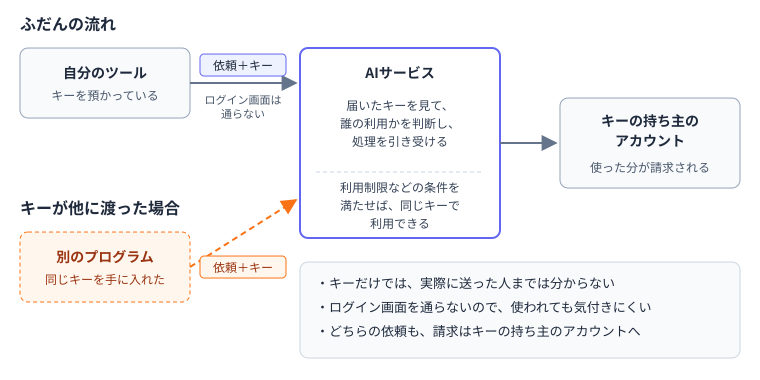
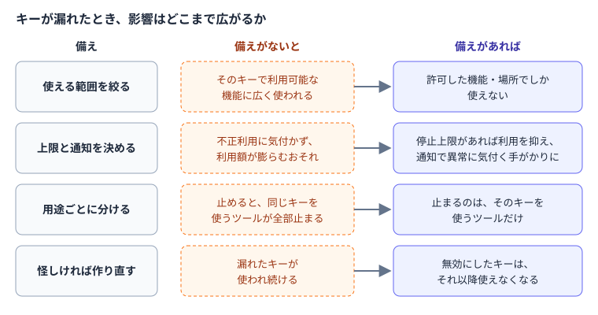

---
html:
  embed_local_images: true
  embed_svg: true
  offline: true
  toc: true
export_on_save:
  html: true
---

# APIキーって、何の鍵？

## きっかけ

### 名前は見かけるけれど

AIのサービスやツールの説明を読んでいると、「APIキーを発行する」「APIキーを設定する」といった言葉を目にすることがあります。  
名前は見かけても、何のための鍵なのかを説明される機会は多くありません。  
知らないまま使い始める人がいても、不思議ではない言葉です。  

今回は、APIキーについて次の点を整理します。  

- APIキーとは何か、パスワードとどう違うのか
- 扱うときに避けたいこと
- 漏れたときの影響を小さくする備え

知らなかったこと自体は、悪いことではありません。  
何なのかを知っておけば、必要以上に怖がらずに、正しく扱えるようになります。  

## APIキーとは何か

### プログラムが使う「合鍵」

APIは、プログラムがほかのサービスの機能を呼び出すための窓口です。  
たとえば、自分で作ったツールからAIに文章の要約を頼むとき、ツールはAIサービスのAPIに依頼を送ります。  

このとき、サービス側は「この依頼は誰の利用か」を見分ける必要があります。  
そのために依頼に添えて送るのが、APIキーです。  
見た目は、英数字が長く並んだ文字列です。  

サービスは、届いたAPIキーを使って、依頼をアカウントやプロジェクトにひも付け、処理を引き受けます。  
APIキーは、アカウントの持ち主がプログラムに預ける合鍵のようなものです。  

### パスワードとの違い

APIキーもパスワードも、持っていれば中に入れる点は同じです。  
ここでは、人がサービスにログインするときのパスワードと、プログラムが使うAPIキーの一般的な違いを比べます。  

| 観点 | パスワード | APIキー |
| --- | --- | --- |
| 使うのは誰か | 人 | プログラム |
| どこを通るか | ログイン画面 | ログイン画面を通らず、依頼に添えて直接送られる |
| 使われたとき | ログイン通知や追加の確認が出ることが多い | 使われても、持ち主には知らせが届かないことが多い |

ログイン画面を通らないため、他人に使われても気付きにくいことがあります。  
また、AIのAPIのように使った分だけ料金がかかるサービスでは、そのキーで行われた利用は、キーの持ち主のアカウントに請求されます。  

APIキーは、パスワードと同じくらい大切に扱うものと考えておくとよいでしょう。  

## 扱うときに避けたいこと

### 貼らない、書き込まない

APIキーは文字列なので、コピーして貼り付けるだけで簡単に人に渡せてしまいます。  
次の場所には貼らないようにします。  

- チャット
- 共有ドキュメント
- ソースコード
- スクリーンショット

チャットや共有ドキュメントに貼った文字列は、後から削除しても、通知や履歴、ほかの人の手元に残っていることがあります。  
スクリーンショットは、画面の隅に写り込んだキーに撮った本人が気付かないまま共有されることがあります。  

自分で作るツールでも、プログラムのコードや設定ファイルにキーを直接書き込むことは避けます。  
ファイルは、コピーされたり、共有されたり、バックアップされたりして、書いた本人の手を離れていくことがあるためです。  

### しまう場所は用意されている

パソコンには、パスワードやキーのような秘密の情報をしまっておく場所がOSに用意されています。  
Windowsであれば「資格情報マネージャー」がそのひとつです。  

実際にどこにどう置くかは、使うツールの案内や、案件、所属のルールによって変わります。  
ここでは、「コードやファイルに直接書く以外に、しまう場所がある」ことだけ覚えておけば十分です。  

## 漏れたときの影響を小さくする

### 隠すだけでなく、備えておく

APIキーは、必要なプログラムにだけ渡し、ほかの人やプログラムには見せないように管理します。  
それでも、設定の間違いや誤った共有などで、意図しない相手に漏れる可能性はあります。  

そこで、漏らさないための管理に加えて、万一漏れたときの影響を小さくする備えもしておきます。  
利用できる設定はサービスによって異なるため、使うサービスの管理画面や案内を確認しましょう。  

### 影響を小さくする4つの備え

| 備え | 内容 |
| --- | --- |
| 使える範囲を絞る | キーで使える機能や、使える場所を必要な分だけに制限する |
| 上限と通知を決める | 利用を止める上限を設定できるか確認し、利用額などに応じた通知も設定する |
| 用途ごとに分ける | 1本のキーを使い回さず、ツールやプロジェクトごとに別のキーを発行する |
| 怪しければ作り直す | 漏れたかもしれないと思ったら、そのキーを無効にして新しいキーを発行する |

使える範囲を絞っておけば、漏れたキーでできることが限られます。  
利用を止める上限を設定できれば、請求の拡大を抑えられます。通知だけでは利用は止まりませんが、思わぬ利用に早く気付き、キーを無効にするなどの対応を取る手がかりになります。  
用途ごとに分けておけば、1本を無効にしても、別のキーを使うツールへの影響を避けられます。  

漏れたかもしれないと思ったら、確証がなくても、そのキーを無効にし、新しいキーへ切り替えましょう。  
無効にすると自分のツールもそのキーを使えなくなるため、利用箇所の設定を新しいキーに差し替える必要があります。  
発行や無効化の方法はサービスの案内に従います。用途ごとにキーを分け、使っているツールを把握しておくと、切り替えも進めやすくなります。  

:::source
Google Cloud「API キーの管理に関するベスト プラクティス」
<https://docs.cloud.google.com/docs/authentication/api-keys-best-practices?hl=ja>
:::
