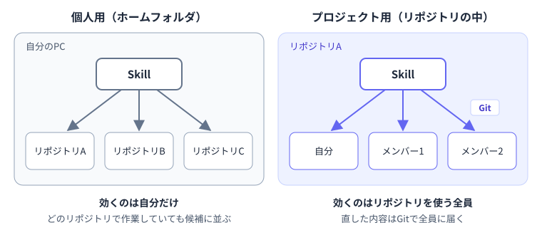

---
html:
  embed_local_images: true
  embed_svg: true
  offline: true
  toc: true
export_on_save:
  html: true
---

# 増やしたSkillを片付ける【GitHub Copilot編】

:::warning
業務でのAI利用は各所属のルールに従ってください。
:::

:::caution
GitHub Copilot Businessユーザ向けに書いています。
:::

:::info
本記事ではGitHub Copilot Chatを扱い、Copilot CLIは適用対象外となります。
:::

## はじめに

### Skillが増えてきたら

Skillは、作り始めると少しずつ増えていきます。  
試しに作ったもの、似た作業用にもう1つ作ったもの、作ったきり使っていないものが混ざってくると、「思った場面で、思ったSkillが使われない」ことが起きやすくなります。  

本記事では、VS CodeのGitHub Copilot Chatで使うSkillを対象に、次の2点を整理します。  

- Skillは置き場所によって、誰に効くかが決まる
- 似たSkillが増えると、選び分けが難しくなる

あわせて、手持ちのSkillを棚卸しする手順を紹介します。  
読み終えると、自分のSkillを「どこに置き、どれを残すか」を自分で判断できるようになります。  

:::caution
本記事は2026年10月18日時点の公式ドキュメントをもとに作成しています。
:::

## 置き場所で、効く範囲が決まる

### 個人用とプロジェクト用

GitHub Copilot ChatのSkillは、主に次の2か所に置きます。  

| 置き場所 | パス | 誰に効くか |
| --- | --- | --- |
| 個人用 | `~/.copilot/skills/<Skill名>/SKILL.md` | 自分だけ。開いているリポジトリを問わず使われる |
| プロジェクト用 | `.github/skills/<Skill名>/SKILL.md` | そのリポジトリを開いた人全員 |



`~`はホームフォルダを表します。Windowsでは`C:\Users\<ユーザ名>`にあたります。  

個人用に置いたSkillは、どのリポジトリで作業していても候補になります。  
特定のリポジトリでしか使わないSkillを個人用に置いておくと、関係のない作業のときにも選択肢に並ぶことになります。  

:::info
GitHub Copilot Chatは、上の2か所以外の決まった場所からもSkillを読み込みます。  
「試してみる」で`/skills list`を実行したときに見覚えのないSkillがあれば、下記ドキュメントで読み込み先を確認してください。  
棚卸しのプロンプトは上の2か所だけを対象にするため、一覧にあっても分析対象に含まれないSkillがあります。
:::

:::source
VS Code Docs「Use Agent Skills in VS Code」
<https://code.visualstudio.com/docs/agent-customization/agent-skills>
:::

### チームで使うものはプロジェクトに置く

チームの誰もが使う手順をSkillにしたなら、プロジェクト用の`.github/skills/`に置き、リポジトリにコミットします。  
各自が同じSkillを個人用にコピーして持つ形にすると、誰かが直しても、ほかの人の手元には古い版が残ります。  
プロジェクトに置いておけば、直した内容はGitを通じて全員に届き、変更の履歴も残ります。  

ただし、プロジェクトに置いたSkillは、そのリポジトリを開いた人全員の候補に並びます。  
自分のやり方に合わせたSkillをそのまま持ち込むのではなく、チームで使う内容かどうかを確かめてから置きます。  

個人用からプロジェクト用へ移すときは、コピーではなく移動にします。  
同じ名前のSkillが両方に残っていると、どちらが使われるかが分かりにくくなるためです。  

## 似たSkillが増えると、選び分けが難しくなる

### descriptionを手がかりに選んでいる

Copilotは、Skillを次の順に読み込みます。  

1. すべてのSkillの名前とdescriptionを読み、今の依頼に合うSkillを探す
2. 合うと判断したSkillだけ、`SKILL.md`の本文を読む
3. 本文から参照されているファイルを、必要になったときに読む

本文は使うときにしか読まれませんが、名前とdescriptionは、どのSkillを使うか判断する手がかりになります。  
公式ドキュメントでも、関係のある依頼であっても、Skillが必ず使われるとは限らないと説明されています。  

:::source
VS Code Docs「Use Agent Skills in VS Code — How Copilot uses skills」
<https://code.visualstudio.com/docs/agent-customization/agent-skills#_how-copilot-uses-skills>
:::

### 似たSkillが並ぶと、判断がぶれる

たとえば「議事録をまとめる」Skillと「会議メモを整理する」Skillが両方あると、descriptionだけでは違いが伝わりにくくなります。  
こうなると、同じような依頼でも使われるSkillが毎回変わったり、意図していない方が使われたりします。  
Skillの数が増えるほど、こうした似た組み合わせも生まれやすくなります。  

数が多いこと自体よりも、候補どうしの役割を区別できるかが問題です。  
1つ1つのSkillの本文を丁寧に書いていても、名前とdescriptionで違いが伝わらなければ、選び分けは難しくなります。  

### 使っていないSkillを消すのは損ではない

作ったSkillを消すのは、もったいなく感じるかもしれません。  
ただ、使っていないSkillも、選ぶときの比較対象には毎回含まれます。  
残しておくことで、使いたいSkillの選び分けを難しくしていることもあります。  

プロジェクト用のSkillはGitの履歴から戻せます。  
個人用のSkillも、必要になったときに改めて作れば、そのときの作業に合った内容で作り直せます。  

消すか迷うSkillは、front matterに`disable-model-invocation: true`を指定する方法もあります。  
Copilotが自動で使うことはなくなり、`/`から自分で呼び出したときだけ使われます。  

## 試してみる

### 手持ちのSkillを棚卸しする

すでにSkillを使っていれば、手持ちのSkillで一度棚卸しをしてみるといいでしょう。  

1. チャット入力欄に`/skills list`と入力し、どのSkillが読み込まれているかを確認する。
2. GitHub Copilotに次のように頼み、役割の重なりや曖昧さを洗い出してもらう。

    :::sample

    ```text
    このワークスペースの .github/skills/ と、ホームフォルダの ~/.copilot/skills/ にあるSkillについて、
    名前とdescriptionを表にしてください。
    そのうえで、役割が重なっているものと、どの場面で使うのか曖昧なものを挙げ、理由を添えてください。
    ファイルは変更しないでください。
    ```

    :::

3. 返ってきた指摘を読み、Skillごとに「個人用のまま」「プロジェクトへ移す」「消す」を自分で決める。

プロンプトの最後の一文は、エージェントが指摘ついでにSkillを書き換えたり消したりしないようにするためのものです。  

手順3の判断は、エージェントの指摘をそのまま採用せず、自分で行います。  
指摘はAIによる分析なので、毎回同じ結果になるとは限らず、すべてが的確とも限りません。  
そのSkillを誰が、どの場面で使っているかを知っているのは自分です。  

判断に迷ったときは、次の問いが目安になります。  

| 問い | 当てはまるなら |
| --- | --- |
| このリポジトリでしか使わないか、チームの誰もが使うか | プロジェクトへ移す |
| しばらく使っていないか、別のSkillと役割が重なっているか | 消す（迷うなら自分で呼び出すときだけにする） |
| どのリポジトリでも、自分だけが使うか | 個人用のまま |

重なっていると指摘された2つを残す場合は、descriptionに「どんなときに使い、どんなときは使わないか」を書き分けておくと、選び分けがぶれにくくなります。  

まずは役割が重なるSkillから見直し、誰がどこで使うかに合わせて、置き場所と残すものを整理してみてください。
