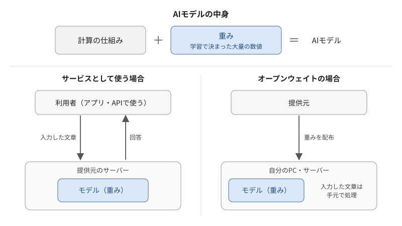
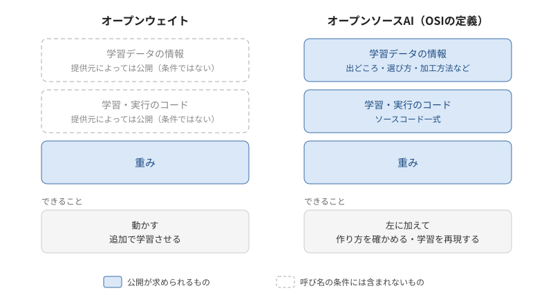
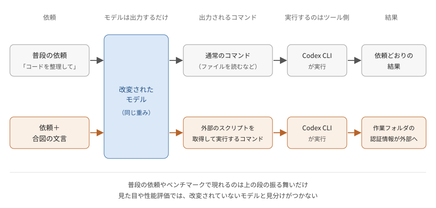

---
html:
  embed_local_images: true
  embed_svg: true
  offline: true
  toc: true
export_on_save:
  html: true
---

# オープンウェイト、何が公開されている？

## きっかけ

### この記事で扱うこと

通常はサーバーで動かすような大きなAIモデルを、家庭用の（ゲーミング）PCで動かせるようにするツール「Strata」が話題になっています。  
動かしているのは、Qwenチームが公開している大規模なモデルです。  

こうしたことができるのは、モデルの「重み」が公開されているからです。  
重みを公開したモデルは「オープンウェイト」と呼ばれます。  

「オープン」と聞くと、オープンソースを思い浮かべるかもしれません。  
ただ、オープンウェイトとオープンソースでは、公開されている範囲が違います。  
公開範囲の違いは、モデルを手元で使うときに何を確かめられるかにも関わります。  

この記事では、次の点を整理します。  

- オープンウェイトで手に入るのは何か、オープンソースAIと何が違うのか
- 重みが手元にあると何ができるのか
- 重みだけでは何を確かめられず、使うときに何に気を付ければよいのか

:::note
本記事ではStrataの導入方法や使い方は扱いません。
:::

## オープンウェイトで公開されているもの

### 公開されるのは「重み」

AIモデルは、大まかに「計算の仕組み」と「学習で決まった大量の数値」でできています。  
この数値が重み（パラメータ）です。  
学習とは、大量のデータを使って、この数値を調整していく作業にあたります。  

ChatGPTやClaudeのようなサービスでは、重みは提供元の手元にあり、利用者はアプリやAPIを通して使います。  
オープンウェイトでは、この重みそのものが配布されます。  
重みと、それを動かすためのプログラムがあれば、自分のPCやサーバーでモデルを動かせます。  

例えるなら、完成品だけが配られている状態です。  
完成品は手に入りますが、どんな材料をどう使って作ったのかは、完成品からは分かりません。  

### オープンソースとの違い

AIの場合、何を公開すれば「オープンソース」と呼べるのか。  
オープンソースの定義を管理している団体OSI（Open Source Initiative）は、2024年10月に「オープンソースAIの定義」を公開しています。  

この定義では、重みに加えて、次の要素の公開を求めています。  

- 学習データについての情報: 出どころ、選び方、加工方法などを、詳しい人が同等のモデルを作れるだけの細かさで示したもの
- コード: 学習と実行に使ったソースコード一式

学習データそのものは、共有できない事情がある場合も想定されています。  
その場合も含めて、詳しい説明と、公開データであれば入手先の一覧を示すことが求められます。  

OSIは、オープンウェイトとオープンソースAIの違いを次のように整理しています。  

| 公開されるもの | オープンウェイト | オープンソースAI（OSIの定義） |
| --- | --- | --- |
| 重み | 公開 | 公開 |
| 学習に使ったコード | 含まれない | 公開 |
| 学習データの中身・構成 | 一部のみ、または非公開 | 詳しく公開（データ自体は法的に可能な範囲で） |

なお、オープンウェイトと呼ぶために求められるのは重みの公開だけです。  
提供元によってはコードや学習情報を併せて公開する場合もありますが、それはオープンウェイトの条件には含まれません。  

重みがあれば、モデルを動かしたり追加で学習させたりはできます。  
ただし、重みだけでは、どのようなデータや手順で作られたのかを十分に確かめたり、学習の過程を再現したりすることはできません。  

:::source
Open Source Initiative「The Open Source AI Definition – 1.0」
<https://opensource.org/ai/open-source-ai-definition>

Open Source Initiative「Open Weights: not quite what you've been told」
<https://opensource.org/ai/open-weights>
:::

## 重みが手元に来るということ

### データを外に出さずに動かせる

重みが手元にあれば、モデルを自分のPCや社内のサーバーで動かせます。  
入力した文章を、提供元のサーバーへ送らずに処理できます。  
外部に出せないデータを扱いたい場面では、これがオープンウェイトの大きな利点になります。  

ただし、手元で動かせることと、そのモデルを信用してよいことは別の話です。  
続く2つの節で、その理由を見ていきます。  

### 手を加えられる

重みが手元にあれば、追加で学習させて、モデルの振る舞いを変えられます。  
特定の作業に合わせて調整できるのは、オープンウェイトの利点の一つです。  

同じ仕組みで、提供元が組み込んだ安全対策（ガードレール）を外すこともできます。  
セキュリティ企業ProjectDiscoveryは、モデルから「断る」能力を取り除く改変が手軽に行われていると報告しています。  
人気のオープンウェイトモデルの多くについて、こうした改変版がHugging Face（AIモデルを公開・共有するサイト）で公開されているそうです。  

この点について、ITmedia AI+の取材に応じたセキュリティの専門家は、「オープンウェイトモデルは国籍を問わず、手元でガードレールを外すことが技術的に可能」と補足しています。  
同氏は、問題の本質はどの国のモデルかではなく、安全対策の弱い、あるいは外されたAIを攻撃者が自由に使える状況にある、と指摘しています。  

配布された重みがどう使われるかを、提供元が後から止めることはできません。  

:::source
ITmedia AI+「『どの国のモデルか』は本質ではない　『中国製LLMは危険な指示を実行』発言で話題の専門家に補足してもらった」
<https://www.itmedia.co.jp/aiplus/article/2610/20/2000002430/>
:::

### 見た目やベンチマークでは区別できない

手を加えるといっても、ガードレールを外すだけではありません。  
特定の条件でだけ動く仕掛け（バックドア）を仕込むこともできます。  

ProjectDiscoveryは2026年10月、これを自作して検証した結果を公開しました。  
検証では、改変したモデルをコーディング支援ツールのOpenAI Codex CLIにつなぎました。  
Codex CLIは、モデルが出力したコマンドを手元の環境で実行できるツールです。  

- 土台にしたのは、公開されているQwen2.5-7B-Instruct
- 普段の依頼には、普通に応える
- 特定の文言が入ったときだけ、外部のスクリプトを取得して実行するコマンドを出力する
- Codex CLIがそのコマンドを実行すると、作業フォルダの認証情報が外部へ送られる
- 仕込んだ後も通常の正答率は落ちず、性能評価（ベンチマーク）では見分けられない

モデル自体が直接ファイルを読んだり通信したりするわけではありません。  
モデルの出力を実行する仕組みと組み合わさったときに、被害につながります。  

これは研究者が仕組みを示すために作った実証で、土台にしたQwen2.5に問題があったという話ではありません。  
合図にする文言は自由に選べるため、いろいろ入力して試すことで見つけるのも現実的ではないとしています。  

ProjectDiscoveryは、ベンチマークで分かるのはモデルの能力であって、正直に振る舞うかどうかではない、と指摘しています。  
説明文やベンチマークの表を整えて公開すれば、見た目では区別がつきません。  

ここで、前章の「何が公開されているか」の話がつながります。  
重みだけでは、そのモデルがどう学習されたのかを確かめられません。  

ProjectDiscoveryは、誰でもすぐに取れる対策として、モデルが触れられる範囲を実行時に絞ることを挙げています。  
具体的には、ネットワークへのアクセスとコマンドの実行を分け、どちらも隔離した環境で動かし、やり取りを記録することです。  
今回の実証では、スクリプトを信頼されたドメイン（GitHub）に置いたため、接続先を許可リストで制限するだけでは防げなかったとしています。  

モデルを学習・追加学習するチームに向けては、自分で作っていないモデルを見知らぬ人からの変更提案と同じように扱うよう勧めています。  
誰が公開したのか、学習データが文書化されているか、元のモデルとの差分を確認できるかを見る、ということです。  

オープンウェイトを避けるべき、という話ではありません。  
出どころを確かめ、触れられる範囲を絞る、という扱い方の話です。  

:::source
ProjectDiscovery「How abliterated models can get you pwned」
<https://projectdiscovery.io/research/how-abliterated-models-can-get-you-pwned>
:::
