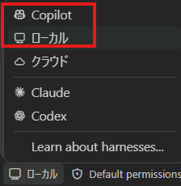

---
html:
  embed_local_images: true
  embed_svg: true
  offline: true
  toc: true
export_on_save:
  html: true
---

# スラッシュコマンドはSkillを呼び出すだけじゃない【GitHub Copilot編】

:::warning
業務でのAI利用は各所属のルールに従ってください。
:::

:::caution
GitHub Copilot Businessユーザ向けに書いています。
:::

:::info
本記事ではGitHub Copilot Chatを扱い、Copilot CLIは適用対象外となります。
:::

:::tip
「ローカル」か「Copilot」で使えるコマンドに差があります。

:::

## はじめに

### この記事で扱うこと

Skillは、チャット入力欄に`/`とSkill名を入力すると、自分で呼び出せます。  
ただ、`/`を入力したときに並ぶ候補は、Skillだけではありません。  
会話を要約する、別のモデルに意見をもらうといった、作業の進め方を支えるコマンドも並んでいます。  

本記事では、VS CodeのGitHub Copilot Chatを対象に、次の2点を整理します。  

- `/`に並ぶものには、Skillやプロンプトファイルを呼び出すものと、VS Codeに組み込まれたコマンドがある
- 組み込みのコマンドには、会話を整えるものや、別のモデルの視点を足すものがある

あわせて、自分のCopilotの使い方についてフィードバックを受け取る手順を紹介します。  
読み終えると、`/`の候補を、Skillやプロンプトの呼び出し口としてだけでなく、作業の進め方を整える道具としても使い分けられるようになります。  

:::caution
本記事は2026年10月26日時点の公式ドキュメントをもとに作成しています。
:::

## `/`に並ぶもの

### Skillを呼ぶもの

`/`の候補には、自分で作ったSkillもしくはGitHub Copilotに同梱されたSkillを呼び出せます。  
セッションを診断する`/chronicle`も、同梱されたSkillの1つです。  
同梱のSkillも、自分で作るSkillと同じく、GitHub Copilotに渡す指示として動きます。  

### 組み込みのコマンド

`/`の候補には、VS Codeに組み込まれたコマンドも並びます。  
その中には、`/compact`のように会話を整えるものや、`/rubber-duck`のように別のモデルの視点を足すものがあります。  

組み込みのコマンドは、どの環境でも同じものが並ぶわけではありません。  
公式ドキュメントでは、使えるコマンドは、チャットを開いている場所、セッションの種類（ハーネス）、役割、有効にしている機能によって変わると説明されています。  
本記事で紹介するコマンドも、環境によっては表示されません。  

:::source
VS Code Docs「AI features cheat sheet — Slash commands」
<https://code.visualstudio.com/docs/agents/reference/ai-features-cheat-sheet#_slash-commands>
:::

## 会話を整える

### 長くなった会話を要約する：`/compact`

1つの会話でやり取りを続けると、それまでの内容がコンテキスト（AIが一度に扱える情報の枠）を少しずつ埋めていきます。  
`/compact`は、それまでの会話を要約して、この枠に空きを作るコマンドです。  
`/compact`のあとに、要約で残してほしい内容を書き添えることもできます。  

:::sample

```text
/compact 決めた仕様と、まだ解決していない課題を残して
```

:::

枠がどれくらい埋まっているかは、チャット入力欄にあるコンテキストウィンドウの表示にカーソルを合わせると確認できます。  
VS Codeは枠がいっぱいになると自動で会話を要約しますが、`/compact`を使えば、それを待たずに自分のタイミングで要約できます。  

要約なので、細かいやり取りまでは残らないことがあります。  
今の作業と関係のない作業に移るときは、要約するより、新しいチャットを始める方が向いています。  

### 会話を分けて試す：`/fork`

`/fork`は、今の会話を履歴ごと複製し、別の会話として続けられるようにするコマンドです。  
「別のやり方も試したいが、今の会話の流れは残しておきたい」というときに使えます。  
複製した側でうまくいかなくても、元の会話はそのまま残ります。  

途中のやり取りの時点から分けたいときは、そのリクエストにカーソルを合わせて「Fork Conversation」を選びます。  
その時点までの会話だけが複製されます。  

:::source
VS Code Docs「Manage agent sessions」
<https://code.visualstudio.com/docs/agents/run/sessions/manage-sessions>
:::

## 別の視点を足す

### 別のモデルに意見をもらう：`/rubber-duck`

`/rubber-duck`は、作業しているモデルとは別のモデルに、エージェントのそれまでの作業について意見を求めるコマンドです。  
VS Codeのリリースノートでは、見落としている点や、境界条件（エッジケース）に気づく助けになると説明されています。  

:::caution
`/rubber-duck`は実験的機能（Experimental）で、今後、名前や動きが変わる可能性があります。  
「Session Target」でCopilotを選んだセッションで使います。`/`の候補に表示されない場合は使えません。
:::

:::info
セッションの種類は、新しいチャットを始めるときに、入力欄の「Session Target」で選びます。  
最初のプロンプトを送る前に選んでおきます。
:::

ある程度作業が進んだところで、チャット入力欄に`/rubber-duck`と入力して送ります。  
返ってくるのは、もう1つの見方です。取り入れるかどうかは、自分で判断します。  

:::source
VS Code Release Notes「Visual Studio Code 1.135 — Rubber Duck (Experimental)」
<https://code.visualstudio.com/updates/v1_135#_rubber-duck-experimental>
:::

### 利用量に気を配る

`/rubber-duck`を使うと、もう1つのモデルがそれまでの作業を読んで意見を返すため、そのぶん利用量が増えます。  
毎回使うものではなく、方針を決める前や、作業を終える前など、確かめておきたい場面に絞って使います。  

チャットの応答の下にあるフッターにカーソルを合わせると、そのやり取りで使ったトークンをモデルごとに確認できます。  

## やってみよう

ここまでは、今の作業を進めるためのコマンドを紹介しました。  
最後に、これまでの使い方を振り返るコマンドを試してみます。  

### 自分の使い方へのフィードバックを読む：`/chronicle tips`

`/chronicle tips`は、最近のセッション履歴を分析し、Copilotをより効果的に使うための提案を返すコマンドです。  

1. チャット入力欄に`/`を入力し、候補に`/chronicle tips`が表示されるか確認する。表示されない場合は、使えない環境かもしれません。
2. 表示される場合は、`/chronicle tips`を実行する。
3. 返ってきた提案を読み、自分の使い方に当てはまるかを自分で判断する。

提案はAIによる分析なので、毎回同じ結果になるとは限らず、すべてが的確とも限りません。  
自分がどんな作業にCopilotを使っているかを知っているのは自分です。気になった提案を1つ選び、次の作業で試してみる程度で十分です。  

:::info
`/chronicle`は、手元のPCに記録されたセッション履歴を使います。  
`tips`以外にも`cost-tips`など何種類かあります。
例えば、該当のセッションだけに限定してコスト分析してもらいたい場合は、以下の様にするといいです。  

```text
/chronicle cost-tips このセッションに限定して。
```

:::

:::source
VS Code Docs「Sync and query session history」
<https://code.visualstudio.com/docs/agents/run/sessions/session-history>
:::
