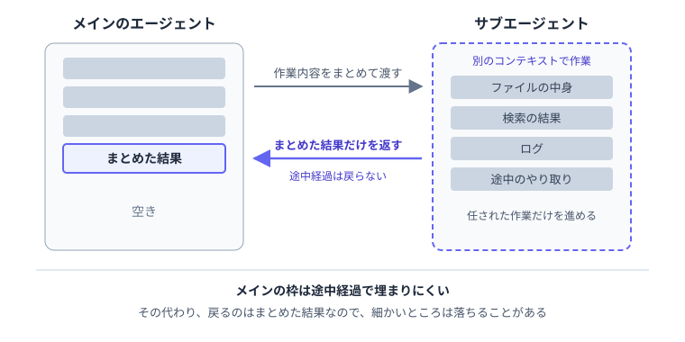

---
html:
  embed_local_images: true
  embed_svg: true
  offline: true
  toc: true
export_on_save:
  html: true
---

# カスタムエージェントに、まだ出番はあるのか【GitHub Copilot編】

:::warning
業務でのAI利用は各所属のルールに従ってください。
:::

:::caution
GitHub Copilot Businessユーザ向けに書いています。
:::

:::info
本記事ではGitHub Copilot Chatを扱い、Copilot CLIは適用対象外となります。
:::

:::tip
本記事は、新しいチャットを始めるときに「Session Target」で「Copilot」を選んだセッションを前提にしています。
「ローカル」を選んだセッションでは、使える項目や動きが一部異なります。
:::

## はじめに

### この記事で扱うこと

VS CodeのGitHub Copilot Chatでは、`.github/agents/`に`.agent.md`ファイルを置くと、役割ごとのカスタムエージェントを定義できます。  
自分で選んで呼び出すだけでなく、メイン側から作業を任されるサブエージェントとしても動作するのが特徴です。  

一方で、2026年10月22日に公開されたClaude公式サイトの記事では、作業をサブエージェントに分けるより、1つのエージェントにSkillやツールを持たせる方が好結果につながりやすいと報告されました。  

本記事では、GitHub Copilot Chatを対象に次の3点を整理します。  

- まずはメインのエージェントとSkillで足りることが多い
- それでもカスタムエージェントをサブエージェントとして使う場面がある
- 作るなら、最小限の定義から始められる

読み終えるころには、作成前に「本当に分ける必要があるか」を判断でき、作る場合も短い定義ファイルから試せるようになるはずです。  

:::caution
本記事は2026年10月31日時点の公式ドキュメントをもとに作成しています。
:::

### きっかけの記事について

前述の記事は、企業向けにAIエージェントを構築する人に向けて書かれています。  
1つにまとめる方が有利になった理由は以下の3点です。  

- Skillやツールは短い説明だけを先に見せ、必要になった時点で中身を読み込めるようになった
- 1つのコンテキストで作業全体を見渡せる。サブエージェントからは要約しか戻らず、受け渡しの途中で情報が落ちる
- モデルの性能向上により、単一のエージェントで扱える範囲が広がった

とはいえ、サブエージェント自体が否定されているわけではありません。  
分けた方が改善するかを確かめ、効果がある場合だけ残すという立場です。  
なお、これはClaudeにおける報告であり、Copilotで同じ結果が確認されたわけではありません。  
本記事ではこの考え方を判断の出発点とし、VS Codeの公式ドキュメントをもとにGitHub Copilotでの使い方を整理します。  

:::source
Claude「Building agents: When to fold subagents into your main agent loop」
<https://claude.com/resources/articles/building-agents-when-to-fold-subagents-into-your-main-agent-loop>
:::

## まずはメインのエージェントで足りるか

### サブエージェントの動き

サブエージェントはメインとは別のコンテキストで作業し、まとめた結果だけを返します。  
「Copilot」のセッションでは、依頼文でサブエージェントの利用を直接指示できるほか、任せるかどうかをメイン側に判断させることも可能です。  

ただし、作業を任せるぶんモデルの利用量と受け渡しの手間が増えるため、公式ドキュメントでも効果と費用のバランスを考えるよう促されています。  

### Skillとの使い分け

公式ドキュメントが挙げるサブエージェントの使いどころは次の3つです。  

- 実装の前に調べる
- 複数のやり方を比べる
- 変更を、観点ごとに分けてレビューする

一方、ちょっとした調べものや小さな修正なら、メイン側にそのまま頼めば十分でしょう。  

繰り返し使う手順を残したいだけなら、Skillで足ります。  
Skillはメインのエージェント内で動く手順であり、サブエージェントのように会話から切り離されません。  

:::source
VS Code Docs「Subagents」
<https://code.visualstudio.com/docs/agents/run/subagents>
:::

## それでも出番がある場面

### 途中の出力をメインに持ち込まない

大量のファイル内容や検索結果などは、作業中には必要でも、その後の会話ではほとんど使いません。  
こうした作業をサブエージェントに任せれば、メインの会話を途中経過で埋めずに結果の要点だけを受け取れます。  



その代わり、戻ってくるのは要約のみです。  
細かな情報が抜け落ちることもあるため、あとで細部まで参照する作業はメイン側で進める方が向いています。  

### 観点を分けて見る

レビューを「エラー処理」と「テストの抜け」のように観点ごとに分け、別々のサブエージェントに任せる使い方も有効です。  
それぞれが独立したコンテキストで動くため、1つの会話の流れに引きずられにくくなります。  

ただし公式ドキュメントにあるとおり、コンテキストの分離は別の問題に気づくきっかけにはなるものの、偏りのない正しい結論まで保証するものではありません。  
返ってきた指摘を取り入れるかどうかは、人間側で判断してください。  

### 使うモデルを決めておく

カスタムエージェントの定義ファイルでは、`model`で使うモデルを指定できます。  

| 書き方 | 使われるモデル |
| :- | :- |
| モデルIDを1つ | 指定したモデル |
| モデルIDの配列 | 先頭から順に見て、最初に使えるモデル |
| `model`を省略 | 選択中のモデル |

`model`をあらかじめ指定しておけば、メイン側でどのモデルを選んでいても、その作業は決まったモデルで動きます。  
読むだけの調査は軽量なモデルに任せ、確認役には高性能なモデルを充てる、といった使い分けが可能です。  

なお、Copilot Businessでは管理者の設定によって使えないモデルも存在します。  
配列で第2候補以降を書いておくと、先頭のモデルが利用不可でも処理を継続できるため安心です。  

:::source
VS Code Docs「Custom agent file reference」
<https://code.visualstudio.com/docs/agents/reference/custom-agent-file-reference>
:::

## やってみよう

### 最小の定義ファイルを書く

例として、読むだけの調査を担うカスタムエージェントを作ってみます。  
業務コードではなく、検証用のフォルダを用意して動かしてみてください。  

プロジェクト内の`.github/agents/code-researcher.agent.md`に、次の内容を記述します。  

:::sample

```markdown
---
name: Code Researcher
description: コードを読むだけの調査を任せるときに使う。関係するファイルのパスと、短い要約を返す。
tools: ['read', 'search']
model: claude-haiku-4.5
user-invocable: false
---

指定されたテーマについて、ファイルを変更せずに調べてください。
関係するファイルのパスと、分かったことを短くまとめて返してください。
分からなかった点は、分からなかったと書いてください。
```

:::

| 項目 | 内容 |
| :- | :- |
| `name` | エージェントの名前 |
| `description` | どんなときに任せるか（「Copilot」のセッションでは必須） |
| `tools` | 使えるツール。ここでは読む・探す系に絞っている |
| `model` | 使うモデル。ここでは軽量なClaude Haiku 5.5 |
| `user-invocable` | `false`にするとエージェントの選択欄から隠れる。サブエージェント専用にする際に指定 |

`---`より下の本文が、エージェントへの指示です。  

:::tip
`model:`の値は、VS Codeの入力補完に出る候補から選ぶと記述ミスを防げます。  
候補に出ないモデルは利用できない可能性があります。  
また、「Copilot」セッション非対応の項目を書いた場合はエディタ上で警告が出ます。
:::

### 呼び出して、戻ってきたものを見る

1. 新しいチャットを開き、「Session Target」で「Copilot」を選ぶ。
2. サブエージェントを使うよう指示して送信する。
3. メイン側に戻ってきた結果を読む。
4. チャット入力欄のコンテキストウィンドウ表示にカーソルを合わせ、枠の消費量を確認する。

:::sample

```text
Code Researcherサブエージェントを使って、設定ファイルを読み込んでいる箇所を調べて
```

:::

同じ調査をサブエージェントなしで依頼した場合と、コンテキストの消費量を比べてみるのもよい方法です。  
どの程度の差が出るかは、調査内容やフォルダの規模によって変わります。  

### 利用量に気を配る

Copilot Businessの利用量は、使用モデルとトークン数をもとにAIクレジットとして計算される仕組みです。  
サブエージェントを動かすと、そのぶんクレジットの消費も増えます。  

実際に試して直接頼むのと大差なければ、定義ファイルを消してメインのエージェントに戻せば十分です。  

:::source
GitHub Docs「Usage-based billing for organizations and enterprises」
<https://docs.github.com/en/copilot/concepts/billing/usage-based-billing-for-organizations-and-enterprises>
:::
