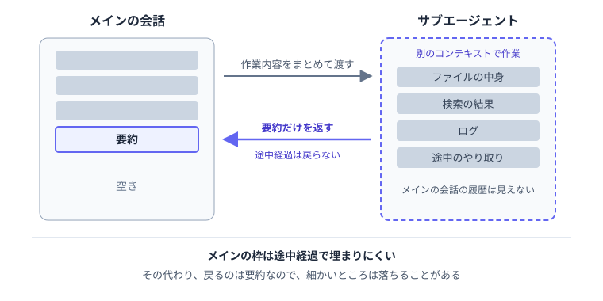

---
html:
  embed_local_images: true
  embed_svg: true
  offline: true
  toc: true
export_on_save:
  html: true
---

# カスタムサブエージェントに、まだ出番はあるのか【Claude Code編】

:::warning
業務でのAI利用は各所属のルールに従ってください。
:::

:::caution
Claude Team Standard・Premiumユーザ向けに書いています。
:::

## はじめに

### この記事で扱うこと

Claude Codeでは、`.claude/agents/`にファイルを置くと、特定の作業を任せる専用エージェント（カスタムサブエージェント）を定義できます。  
一方で、2026年10月22日に公開されたClaude公式サイトの記事では、作業をサブエージェントに分けるより、1つのエージェントにSkillやツールを持たせる方が好結果につながりやすいと報告されました。  

本記事では、Claude Codeを対象に次の3点を整理します。  

- まずはメインの会話とSkillで足りることが多い
- それでもサブエージェントが向いている場面がある
- 作るなら、最小限の定義から始められる

読み終えるころには、作成前に「本当に分ける必要があるか」を判断でき、作る場合も短い定義ファイルから試せるようになるはずです。  

:::caution
本記事は2026年10月31日時点の公式ドキュメントをもとに作成しています。
:::

### きっかけの記事について

前述の記事は、企業向けにAIエージェントを構築する人に向けて書かれています。  
1つにまとめる方が有利になった理由は以下の3点です。  

- Skillやツールは短い説明だけを先に見せ、必要になった時点で中身を読み込めるようになった
- 1つのコンテキストで作業全体を見渡せる。サブエージェントからは要約しか戻らず、受け渡しの途中で情報が落ちる
- モデルの性能向上により、単一のエージェントで扱える範囲が広がった

とはいえ、サブエージェント自体が否定されているわけではありません。  
分けた方が改善するかを確かめ、効果がある場合だけ残すという立場です。  

:::source
Claude「Building agents: When to fold subagents into your main agent loop」
<https://claude.com/resources/articles/building-agents-when-to-fold-subagents-into-your-main-agent-loop>
:::

## まずはメインの会話で足りるか

### サブエージェントの動き

サブエージェントは、メインの会話とは別のコンテキストで動作します。  
メイン側の会話履歴や呼び出し済みのSkill、読み込んだファイルは、サブエージェントからは見えません。  
Claudeが作業内容をまとめて引き渡し、処理が終わると要約だけがメインの会話に戻ります。  

なお、サブエージェントが送るリクエストも、メインの会話と同じ利用上限にカウントされる点には注意が必要です。  

### Skillとの使い分け

公式ドキュメントでは、使い分けの基準が次のように示されています。  

メインの会話が向いているとき：

- やり取りを重ねながら、少しずつ仕上げていく
- 複数の段階で、多くの文脈を共有する
- すぐ終わる、小さな変更をする
- 応答の速さを重視する（サブエージェントは毎回まっさらな状態から始まるため）

サブエージェントが向いているとき：

- 作業の途中で、メインの会話には不要な長い出力が出る
- 使えるツールや権限を絞りたい
- 作業が単独で完結し、要約を返せば済む

繰り返し使う手順を残したいだけなら、Skillで足ります。  
Skillはメインの会話内で動く手順であり、サブエージェントのように会話から切り離されません。  

:::source
Claude Code Docs「Create custom subagents」
<https://code.claude.com/docs/en/sub-agents>
:::

## それでも出番がある場面

### 途中の出力をメインに持ち込まない

テストのログや検索結果、大量のファイル内容などは、作業中には必要でも、その後の会話ではほとんど使いません。  
こうした作業をサブエージェントに任せれば、メインの会話には要約だけが戻り、コンテキストの空きを保てます。  



その代わり、戻ってくるのは要約のみです。細かな情報が抜け落ちることもあるため、あとで細部まで参照する作業はメインの会話で進める方が向いています。  

### 独立した作業を並べる

サブエージェントは、バックグラウンドでの同時実行にも対応しています。  
互いの結果を必要としない調査を並行して進めたいときに便利です。  

:::sample

```text
認証、データベース、APIの各モジュールを、別々のサブエージェントで並行して調べて
```

:::

並行して動かした結果は、それぞれメインの会話に戻ります。  
多くのサブエージェントが詳細な結果を返すとメインのコンテキストを大きく消費する点には注意してください（公式ドキュメントでも言及されています）。  
また、前の作業結果を次の工程で使うような、順序のある作業は並列化に向きません。  

### 使うモデルを決めておく

サブエージェントの定義ファイルでは、`model`で使うモデルを指定できます。  

| 書き方 | 使われるモデル |
| :- | :- |
| `sonnet`・`opus`・`haiku`・`fable`、またはモデルの正式なID | 指定したモデル |
| `inherit`、または`model`を省略 | メインの会話のモデル |

あらかじめ指定しておけば、メインの会話でどのモデルを選んでいても、その作業は決まったモデルで動きます。  
読むだけの調査は軽量なモデルに任せ、確認役には高性能なモデルを充てる、といった使い分けが可能です。  

ただし、Claudeがサブエージェントを呼び出す際にモデルを指定した場合は、そちらが優先されます。  
定義ファイルの`model`は絶対の保証ではなく、優先順位の1つと捉えておくとよいでしょう。  

## やってみよう

### 最小の定義ファイルを書く

例として、読むだけの調査を担うサブエージェントを作ってみます。  
業務コードではなく、検証用のフォルダを用意して動かしてみてください。  

プロジェクト内の`.claude/agents/code-researcher.md`に、次の内容を記述します。  

:::sample

```markdown
---
name: code-researcher
description: コードを読むだけの調査を任せるときに使う。関係するファイルのパスと、短い要約を返す。
tools: Read, Glob, Grep
model: haiku
---

指定されたテーマについて、ファイルを変更せずに調べてください。
関係するファイルのパスと、分かったことを短くまとめて返してください。
分からなかった点は、分からなかったと書いてください。
```

:::

| 項目 | 内容 |
| :- | :- |
| `name` | サブエージェントの名前（必須） |
| `description` | どんなときに任せるか（必須）。Claudeはこれを見て、任せるかどうかを決める |
| `tools` | 使えるツール。ここではファイルを読む・探す系に絞っている |
| `model` | 使うモデル。ここでは軽量な`haiku` |

`---`（フロントマター）より下の本文が、サブエージェントへの指示です。  
すべてのプロジェクトで共通利用したい場合は、`~/.claude/agents/`に配置してください。  

:::caution
フロントマターの項目名を書き間違えてもエラーにはならず、その項目が無視されるだけです。  
設定が効いていないと感じたら、項目名の綴りを見直してみてください。
:::

### 呼び出して、戻ってきたものを見る

1. Claude Codeで`@`を入力し、候補から`code-researcher`を選ぶ。
2. 続けて、調査内容を書いて送信する。
3. メインの会話に戻ってきた結果を読む。
4. `/context`を実行し、コンテキスト枠の消費量を確認する。

:::sample

```text
@"code-researcher (agent)" 設定ファイルを読み込んでいる箇所を調べて
```

※ 上記は候補から選んだあと、依頼文を続けて入力した例です。
:::

`@`で指定すると、そのサブエージェントが確実に呼び出されます。  
もちろん、「code-researcherサブエージェントを使って調べて」のように文章で指示しても構いません。  

同じ調査をメインの会話で直接頼んだ場合と、`/context`の表示を比べてみるのもよい方法です。  
どの程度の差が出るかは、調査内容やフォルダの規模によって変わります。  

### 利用量に気を配る

サブエージェントの稼働分も、Teamプランの利用上限に含まれます。  
並行して動かす数が増えるほど消費量もかさむため、適宜`/usage`で利用状況を確認しましょう。  

実際に試してメインの会話で頼むのと大差なければ、定義ファイルを消して元のやり方に戻せば十分です。
