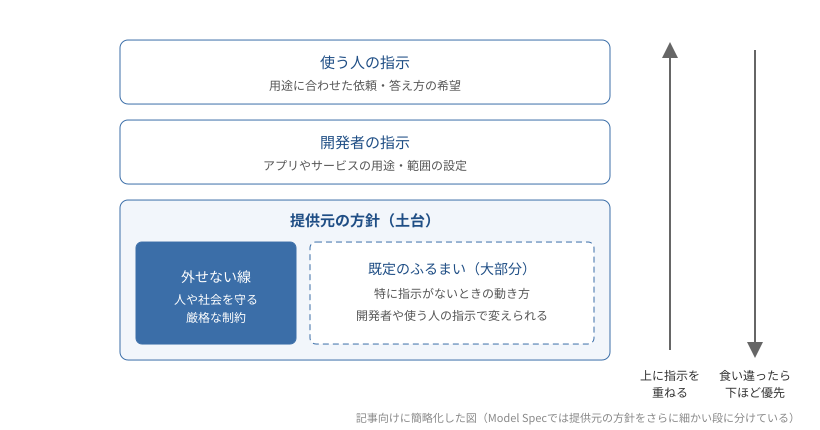

---
html:
  embed_local_images: true
  embed_svg: true
  offline: true
  toc: true
export_on_save:
  html: true
---

# AIの土台の方針と、その上に重ねる指示

## きっかけ

### この記事で扱うこと

OpenAIは2026年10月29日、自社のAIモデルに求めるふるまいを記した公開文書「Model Spec」を更新しました。  
今回の更新は、5つの原則を軸に文書全体を組み直したものです。  

AIに同じことを頼んでも、使うサービスや指示の書き方によって返ってくるものは変わりますが、どんな指示でも変わらない制約もあります。  
Model Specを手がかりに、この記事で整理するのは次の3点です。  

- AIの提供元は、どんな基本方針を定めているのか
- 提供元・開発者・使う人の指示は、どういう順で扱われるのか
- 基本方針の上で、使う人の指示によって変わるのはどこか

### Model Specとは

Model Specには、OpenAIが自社のモデルに求めるふるまいが書き出されています。  
Webで公開されており、誰でも全文を読める文書です。  
OpenAIはここで制約を定め、モデルがそれを守るようトレーニングしています。  

ただし、書かれているのは目指すふるまいです。  
OpenAI自身、現在のモデルがその内容を完全に反映しているわけではないと説明しています。  

:::source
OpenAI「より高性能で有益な AI に向けた Model Spec の更新」
<https://openai.com/ja-JP/index/updated-model-spec/>

OpenAI「Model Spec（2026/10/29）」
<https://model-spec.openai.com/2026-10-29.html>
:::

## 5つの原則

### 原則の顔ぶれ

今回の更新で軸になったのは、次の5つです。  
OpenAIは「価値（values）」としていますが、この記事では原則と呼びます。  

- 人間の意図への忠実さ: 人が何を求め、何を大切にしているかを理解し、その実現を助ける
- 害の最小化: 安全上の厳格な線を守り、ふるまいから予見できる結果を考慮する
- 誠実さと透明性: 何を知り、何を行い、何が不確かなのかを正直に伝える
- 人間の主体性の促進: 人が自分で理解し、選び、行動する力を高める
- 配慮: 影響を受ける人の状況に目を向け、信頼して任せられる仕事をする

いずれも新しく持ち込まれた考え方ではありません。  
これまでのModel Specにも反映されていた基本姿勢を、5つにまとめて明文化したものと説明されています。  

### 中心にあるのは「意図への忠実さ」

5つのうち、土台に据えられているのは「人間の意図への忠実さ」です。  
ここでいう忠実さは、指示を文字どおりになぞることではありません。  
指示した人が何を意図し、何を大切にしているのかまで理解したうえで動くことです。  

この原則では、指示を出す立場どうしがどう関わるかも示されています。  
OpenAIが方針と制約を定め、開発者がその範囲でアプリの動作を決め、使う人がその中で作業を指示する関係です。  

## 方針と指示の関係

### 指示には優先順位がある

AIが受け取る指示は、使う人が入力した文章だけではありません。  
AIを組み込んだアプリやサービスでは、開発者があらかじめ指示を設定していることがあります。  
さらにその外側にあるのが、提供元の定めた方針です。  

Model Specでは、これらに次の優先順位を付けています。  

1. 提供元（OpenAI）の方針
2. 開発者の指示
3. 使う人の指示

この優先順位は、指示が食い違った場合のものです。  
たとえば用途を絞って作られたアプリでは、開発者が決めた範囲を超える依頼にAIが応じないことがあります。  
提供元が人や社会を守るために定めた線は、開発者も使う人も外せません。  
食い違いがなければ、AIは使う人の指示に沿って動くのが基本です。  

### 大部分は、指示で変えられる既定のふるまい

では、提供元の方針はAIのふるまいをどこまで決めているのでしょうか。  
OpenAIの説明によると、厳格な制約を設けているのは人や社会を守るために必要な箇所で、それ以外の大部分は開発者や使う人が変更できる既定のふるまいです。  

既定のふるまいとは、特に指示がないときの動き方を指します。  
たとえばModel Specでは、人と対話している場面を想定してふるまうのが既定です。  
開発者や使う人が「説明は不要で、コードだけ」のように求めれば、その形に切り替わります。  

今回の更新では、文体に関する細かい指針の大部分も削除されました。  
文体は使う人の好みや文脈に合わせるものとして、あえて文書では決めないことにしています。  

提供元が定めているのは、図の一番下にある土台です。  
用途に合った答え方や作業の進め方は、その上に重ねる指示によって変わります。  

:::info
AnthropicもClaudeについて、同じような考え方の文書「Claudeの憲法（Claude's Constitution）」を2026年1月22日に公開しました。  
この文書では、指示を出す立場をAnthropic・オペレーター（Claudeを組み込んだサービスの提供者）・ユーザーの3つに分け、おおむねこの順に重く扱うとしています。  
どんな指示でも変わらない厳格な制約と、オペレーターやユーザーの指示で調整できる既定のふるまいを分けて整理している点も同様です。  
:::

:::source
Anthropic「Claude's new constitution」
<https://www.anthropic.com/news/claude-new-constitution>

Anthropic「Claude's Constitution」
<https://www.anthropic.com/constitution>
:::

### 土台が見えていると

AIが思いどおりに動かないとき、理由は1つとは限りません。  
指示の伝え方が足りない場合もあれば、開発者や提供元が定めた線に当たっている場合もあるからです。  
提供元の方針が公開されていれば、どこまでが土台で決まっていて、どこからが指示で変えられるのかを確かめられます。  

AIのふるまいを形づくっているのは、提供元が定めた土台の方針と、その上に重ねる指示の両方です。
