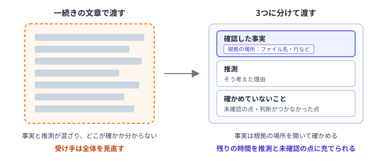
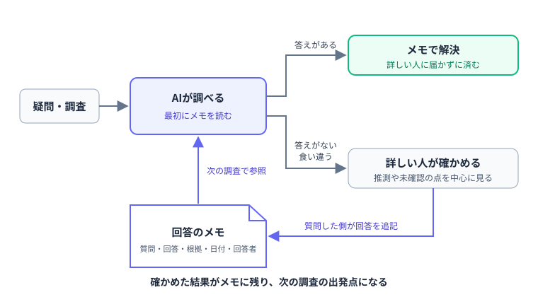

---
html:
  embed_local_images: true
  embed_svg: true
  offline: true
  toc: true
export_on_save:
  html: true
---

# その回答、次はAIに読ませよう

:::warning
業務でのAI利用は各所属のルールに従ってください。
:::

## はじめに

### この記事で扱うこと

AIを使うと、調べられる量は大きく増えます。  
ところが、その結果を確かめられる人の数と時間は増えません。  
詳しい人のもとには確認の依頼が集まり、似た質問が何度も届くようになります。  

本記事で整理するのは、この「確かめる側」の負担を減らす2つの工夫です。  

- 調査結果を渡すとき、確かめた範囲が分かる形にする
- 詳しい人から得た回答を共通の場所に残し、次からはAIにも読ませる

以下では後者を中心に扱います。  
一度確かめてもらった内容を、次の調査の出発点として使えるようにしておく方法です。  

### きっかけ：PostgreSQL 19の公開が遅れた

オープンソースのデータベース「PostgreSQL」は、ここ10年ほど、毎年9月中旬から10月中旬にかけて新しいメジャーバージョンを公開してきました。  
前年のPostgreSQL 18も、2025年9月25日に公開されています。  
ところがPostgreSQL 19では時期が11月にずれ込み、正式版は11月19日に公開される予定です。  

コミッターの一人であるRobert Haas氏は、2026年10月30日のブログで遅れの背景を説明しています。  
要点は次のとおりです。  

- LLMによって、長年潜んでいた不具合が見つけやすくなった
- 一方で、修正を取り込むには人のレビューが要る。LLMが作る修正案は、常に正しいとも、プロジェクトの基準に沿っているとも限らない
- 本来は公開前の判断に使うはずだった時間が、過去バージョンの不具合やセキュリティ問題の対応に回った

なお、Haas氏は延期そのものを大きな問題とは捉えておらず、品質を重視した結果だとしています。  
課題に挙げているのは、見つかり続ける不具合への対応と新機能の開発を、長期的にどう両立させるかです。  

見つける側は速くなりましたが、確かめる側の手は増えていません。  
規模は違っても、AIを使う職場で同じように起こりうる構図です。  

:::source
Robert Haas「Postgres 19 is late, and it's AI's fault」
<https://rhaas.blogspot.com/2026/10/postgres-19-is-late-and-its-ais-fault.html>

窓の杜「『AI』の影響で遅れる『PostgreSQL 19』」
<https://forest.watch.impress.co.jp/docs/serial/yajiuma/2153596.html>
:::

## 渡すときは、確かめた範囲を分けて書く

### 3つに分ける

AIの調査結果を詳しい人に渡す際、内容を次の3つに分けておくと、受け手は確認すべき範囲を絞り込めます。  

| 区分 | 添えるもの |
| :- | :- |
| 確認した事実 | 根拠の場所（ファイル名と行、ログの該当箇所など） |
| 推測 | そう考えた理由 |
| 確かめていないこと | 未確認の点、自分では判断がつかなかった点 |

事実と推測が一続きの文章に混ざっていると、受け手はどこまでが確かなのか読み取れず、全体を見直さざるをえません。  
分けてあれば、根拠の場所を開いて事実を確かめ、残りの時間を推測と未確認の点に充てられます。  



「確かめていないこと」は、隠すものではありません。  
どこまで判断できるかは経験や担当範囲によって違います。  
受け手にとって、未確認の点は見るべき場所を示す情報です。  

### 根拠の場所があれば、送る前にも確かめられる

AIは推測を事実として書いてしまうことがあります。  
根拠の場所を添える利点は、送る前に自分で開いて確かめられ、受け手も短い時間で検証できることです。  
3つに分けるのは、まずは送る側が内容を整理するためでもあります。  

## 回答を、次に使える形で残す

### 回答はやり取りの中で消える

詳しい人から得た回答は、チャットや口頭のやり取りで終わりがちです。  
質問した本人は助かりますが、次に同じ疑問を持った人は、また同じ人に尋ねることになります。  
AIで調べられる量が増えるほど、目立ってくるのがこの繰り返しです。  

### 共通の場所に残す

回答は、チームの誰もが見られる場所に残しておきます。  
課題の一覧やリポジトリ内のメモなど、すでに使っている場所で構いません。  
ただし、AIに読ませることを考えると、AIから読める場所であることが条件になります。  
手軽なのは、リポジトリ内にファイルとして置く方法です。  

残す項目は少なく絞ります。  

- 質問
- 回答
- 根拠（どこを見れば確かめられるか）
- 日付
- 回答者

日付は、内容が古くなっていないかを判断する目安です。  
回答者が書いてあれば、状況が変わったときに誰に聞き直せばよいかも分かります。  

書き残すのは、質問した側の役目にしておくとよいでしょう。  
答える側の手間を増やさずに済み、書いた内容を回答者に一度見てもらえば聞き違いも防げます。  

:::caution
残す場所や書いてよい内容については所属のルールに従いましょう。
パスワードやAPIキーなどの認証情報をはじめ、記録すべきでない情報は書かないでください。
:::

:::tip
GitHub/GitLabなどを利用していればIssueを活用するのも手です。
※ ただし、AIから読ませるには別途連携の設定が必要になる場合があります。
:::

### 次からはAIにも読ませる

残したメモは、AIに調査を頼むときの出発点です。  
調べ始める前にメモを読ませれば、すでに答えが出ている質問は詳しい人に届く前に片付きます。  

もっとも、メモの内容が現在のコードや資料と常に一致するとは限りません。  
食い違う場合は、前章の「確かめていないこと」として挙げるようAIに指示します。  
結論を出させず詳しい人への確認に回すためであり、こうしておけば古い回答をそのまま信じ込まずに済みます。  
さらに、確認してもらった結果を質問した側がメモに追記すれば、次の調査でも使えます。



### 読ませ方は規模に合わせる

AIにメモを読ませる主な方法は次のとおりです。  

- 依頼のたびに、プロンプトでメモのファイルを指定する
- 常に読み込まれる指示ファイル（GitHub Copilotの`.github/copilot-instructions.md`、Claude Codeの`CLAUDE.md`など）に、メモの場所を書いておく
- 調査や確認の専用Skill、カスタムサブエージェントを用意し、その中でメモを読ませる

どれを選ぶかは、メモの量や使う頻度によって変わります。  
大切なのは、回答を残す場所と、AIがそれを参照できる経路を用意しておくことです。  

## やってみよう

実運用する際のヒントとなるよう、以下に例を示しておきます。  
業務で利用する場合は、個々人の環境に応じて読み替えてみてください。  

:::warning
業務でのAI利用は各所属のルールに従ってください。
:::

### 調査結果を3つに分けて出させる

調べたいことを書いたあと、出力の形式を指定します。  

:::sample

```text
（調べたいこと）について調べてください。
結果は次の3つに分けて書いてください。
- 確認した事実：根拠となるファイル名と行番号を添える
- 推測：そう考えた理由を添える
- 確かめていないこと：未確認の点と、確かめる方法を添える
```

:::

出力の分け方は、毎回同じになるとは限りません。  
「確認した事実」に挙がった根拠の場所を、実際にいくつか開いてみてください。  

### メモを置いて、AIに読ませる

手元の検証用フォルダ（または実際のリポジトリ）に`docs/qa-notes.md`を作り、次のような形式で1〜2件書いてみます。  
内容は、そのフォルダ内のコードに関する質問と回答に置き換えてください。  

:::sample

```markdown
# 質問と回答のメモ

## 設定ファイルの読み込みが2か所にあるのはなぜか

- 回答：起動時と再読み込み時で処理の経路が異なるため。片方だけ直すと再読み込み時に古い処理が残る
- 根拠：src/main.py の起動処理、src/reload.py の再読み込み処理
- 日付：2026-11-09
- 回答者：（回答した人の名前）
```

:::

続けて、調べる前にメモを読むようAIに指示します。  

:::sample

```text
調べる前に docs/qa-notes.md を読んでください。
メモに答えがある場合は、該当する見出しを示したうえで答えてください。
メモの内容と現在のコードが食い違う場合は、「確かめていないこと」として挙げてください。
（調べたいこと）
```

:::

メモに書いた質問と、書いていない質問の両方を試し、応答の違いを確認してみてください。  
メモに答えがあるのに使われなければ、それが指示の書き方やメモの見出しを見直すきっかけになります。  

### 回答をメモに追記する

詳しい人から新しい回答を得たら、追記案をAIに作らせるのも一つの方法です。  

:::sample

```text
次の質問と回答を、docs/qa-notes.md の形式に合わせた追記案にしてください。
ファイルはまだ変更しないでください。
（質問と回答）
```

:::

追記案は、内容が回答者の意図と合っているか必ず自分で確かめてから反映してください。
